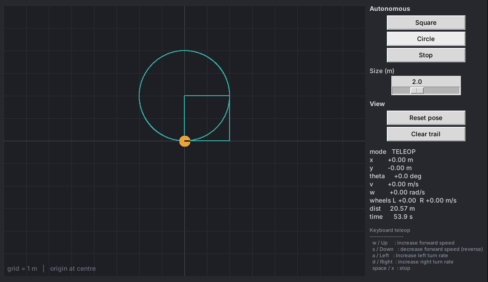

# ROS 2 Robotics Starter

A small, beginner-friendly robotics repo with two parts:

1. **`sim/`**: a **standalone 2D robot simulator** that needs only Python's standard library (Tkinter). No ROS and no `pip install`. You can drive the robot with the keyboard or have it drive a square or circle by itself.
2. **`src/robotics_starter/`**: a **ROS 2 Jazzy** Python package with the classic examples: publisher/subscriber, service server/client, keyboard teleop, and a square/circle shape follower.

Both parts share the same motion code ([`motion.py`](src/robotics_starter/robotics_starter/motion.py)), so the robot behaves the same in the simulator and under ROS.



---

## Repository layout

```
ros2_robotics_starter/
├── sim/
│   ├── tk_sim.py              # standalone Tkinter simulator (python3 sim/tk_sim.py)
│   └── test_sim_core.py       # headless tests for the simulator logic
├── src/robotics_starter/      # ROS 2 ament_python package
│   ├── robotics_starter/
│   │   ├── motion.py          # pure-Python kinematics, teleop and shape logic (shared)
│   │   ├── talker.py          # publisher   -> /chatter (std_msgs/String)
│   │   ├── listener.py        # subscriber  <- /chatter
│   │   ├── add_service.py     # service server /add_two_ints (example_interfaces/AddTwoInts)
│   │   ├── add_client.py      # service client
│   │   ├── teleop_keyboard.py # keyboard   -> /cmd_vel (geometry_msgs/Twist)
│   │   └── shape_follower.py  # square/circle -> /cmd_vel
│   ├── launch/                # pubsub, service, shape_turtlesim launch files
│   ├── config/shape_follower.yaml
│   ├── test/test_motion.py
│   ├── package.xml
│   └── setup.py
└── docs/simulator.png
```

---

## 1. Standalone simulator (no ROS)

Requirements: Python 3.8+ with Tkinter.

| OS | Tkinter |
|----|---------|
| Windows / macOS (python.org installer) | included |
| Ubuntu / Debian | `sudo apt install python3-tk` |

```bash
python3 sim/tk_sim.py
```

| Control | Action |
|---------|--------|
| `w` / ↑ | increase forward speed |
| `s` / ↓ | decrease forward speed (reverse) |
| `a` / ← | turn left more |
| `d` / → | turn right more |
| `space` / `x` | stop |
| **Square** / **Circle** buttons | run the autonomous shape (the **Size** slider sets the side length or radius) |
| **Stop**, **Reset pose**, **Clear trail** | as named |

The panel shows the live pose (x, y, θ), the commanded `v` and `ω`, the left and right wheel speeds, the distance travelled and the elapsed time. The world is 16 m × 12 m with a 1 m grid and the origin at the centre.

Teleop is *incremental*: each key press nudges the speed, and the robot keeps going until you press `space`. The ROS `teleop_keyboard` node works the same way.

---

## 2. ROS 2 package

### Prerequisites

- Ubuntu 24.04 with [ROS 2 Jazzy](https://docs.ros.org/en/jazzy/Installation.html) (`ros-jazzy-desktop` includes turtlesim)
- `colcon`: `sudo apt install python3-colcon-common-extensions`

### Build

```bash
source /opt/ros/jazzy/setup.bash
cd ros2_robotics_starter
colcon build --symlink-install
source install/setup.bash
```

Run `source install/setup.bash` in **every new terminal**.

### Demo A: publisher / subscriber

```bash
ros2 launch robotics_starter pubsub.launch.py message:="Hi robot"
```

Or run each side in its own terminal: `ros2 run robotics_starter talker` and `ros2 run robotics_starter listener`.

### Demo B: service server / client

```bash
ros2 launch robotics_starter service.launch.py a:=7 b:=5
```

Or by hand:

```bash
ros2 run robotics_starter add_service
```

```bash
ros2 run robotics_starter add_client 3 4
```

```bash
ros2 service call /add_two_ints example_interfaces/srv/AddTwoInts "{a: 1, b: 2}"
```

### Demo C: shape follower (watch it in turtlesim)

```bash
ros2 launch robotics_starter shape_turtlesim.launch.py shape:=circle size:=2.0
```

Or point it at any robot that listens on `cmd_vel`:

```bash
ros2 run robotics_starter shape_follower --ros-args -p shape:=square -p size:=1.5
```

| Parameter | Default | Meaning |
|-----------|---------|---------|
| `shape` | `square` | `square` or `circle` |
| `size` | `2.0` | side length (square) or radius (circle), in m |
| `linear_speed` | `0.5` | m/s |
| `angular_speed` | `0.8` | rad/s for the square's 90° turns |
| `loops` | `1` | how many times to repeat the shape |
| `rate` | `20.0` | publish rate in Hz |

### Demo D: keyboard teleop

Teleop needs its own interactive terminal, so start it with `ros2 run` rather than a launch file.

```bash
ros2 run turtlesim turtlesim_node
```

```bash
ros2 run robotics_starter teleop_keyboard --ros-args -r cmd_vel:=/turtle1/cmd_vel
```

Optional parameters: `linear_step`, `angular_step`, `max_linear`, `max_angular`.

### Useful inspection commands

```bash
ros2 topic list
```

```bash
ros2 topic echo /cmd_vel
```

```bash
rqt_graph
```

---

## How it works

**Kinematics:** the robot is modelled as a unicycle / differential drive. For a constant linear speed `v` and turn rate `ω` held for `dt` seconds, `integrate()` uses the exact arc solution:

```
θ' = θ + ω·dt
x' = x + (v/ω)·(sin θ' − sin θ)
y' = y − (v/ω)·(cos θ' − cos θ)          (straight line when ω ≈ 0)
```

Wheel speeds come from `v_left = v − ω·L/2` and `v_right = v + ω·L/2`, where `L` is the wheel base.

**Shapes:** `ShapeFollower` turns a shape into timed segments of `(v, ω, duration)`:
- **Square:** drive forward for `size / v`, then turn 90° for `(π/2) / ω`, four times.
- **Circle:** drive with `ω = v / r` for `2πr / v`.

It is **open-loop**: it uses no position feedback, so it works with any `cmd_vel` robot. On real hardware, wheel slip makes the shape drift. Closing the loop using `/odom` is a good next exercise.

---

## Tests

The tests need no ROS and no display:

```bash
pip install pytest
```

```bash
python3 -m pytest src/robotics_starter/test sim
```

Inside a ROS workspace, `colcon test --packages-select robotics_starter` also runs the package tests.

## Ideas to extend

- A closed-loop go-to-goal controller (PID on distance and heading) using `/odom` or `/turtle1/pose`
- Obstacles and collision checking in the simulator
- Publishing the simulator's pose as ROS `/odom` and TF

## License

MIT. See [LICENSE](LICENSE).
